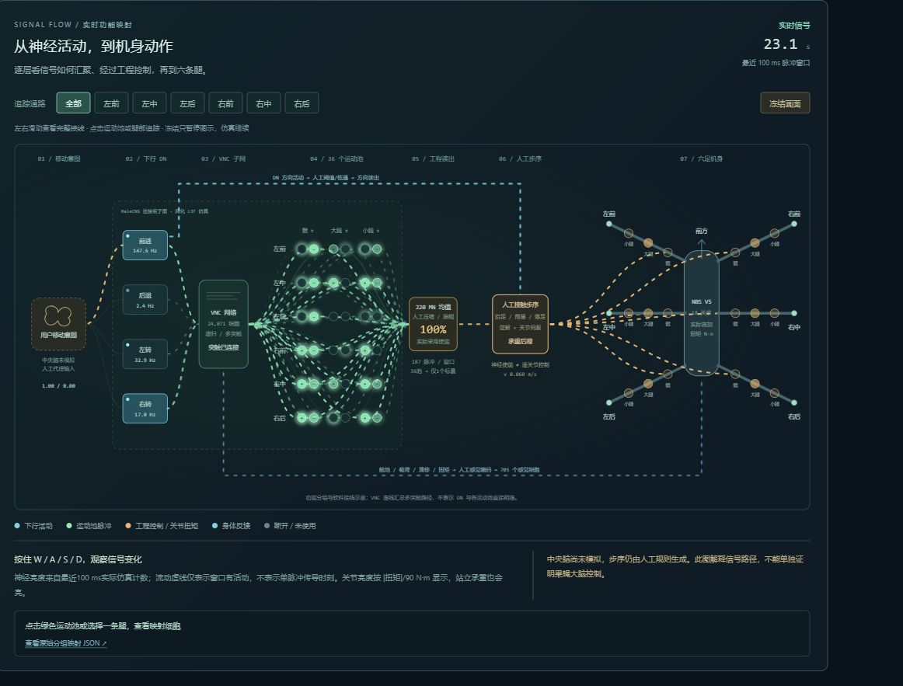
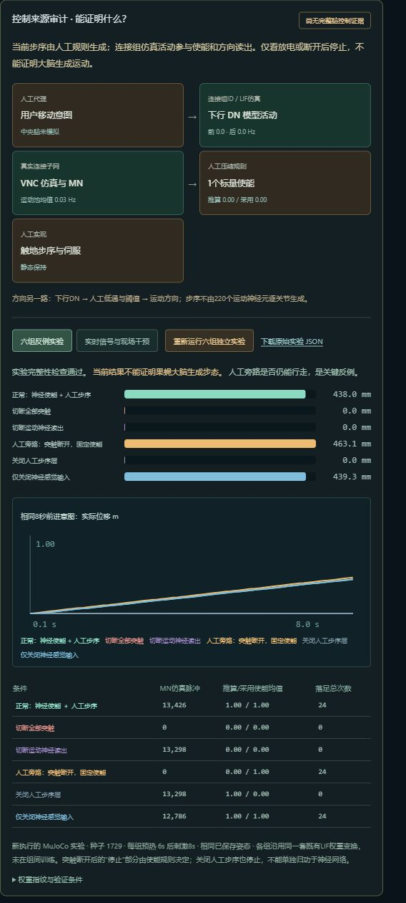

# 苍蝇神经连接六足机器人

基于 **MuJoCo + MaleCNS 下行/VNC 连接组子网 + Python + React/Three.js** 的六足机器人仿真实验台。浏览器输入前进、后退和转向意图，观察模型放电、足端反馈、关节扭矩与机身运动。

> 当前不是完整果蝇大脑。神经活动参与使能和方向读出，步序由明确标注的人工接触规则、逆解和伺服生成。动态图展示实际仿真数据，不能单独证明果蝇大脑产生步态。



## 给同事试运行：下载离线快捷包

从本仓库 **[Releases](https://github.com/IceSakura0001/fly-neural-hexapod/releases)** 下载 `Hexapod-Neuro-QuickStart-20261023.zip`（约261 MiB），完整解压后双击 **启动.cmd**。启动成功会自动打开浏览器。

- 需要 Windows 10/11 x64、Docker Desktop 的 Linux 容器 / WSL2 引擎，以及支持 WebGL 的浏览器。
- 建议16 GB内存，Docker至少约5 GB可用内存；快捷包默认限制为2 CPU / 4 GB。建议预留8 GB磁盘空间。
- 镜像、Python依赖、已构建网页、用户模型和处理后的神经数据都在包内，不需要另装Python、Node或下载神经数据。
- Docker Desktop / WSL2 的安装与首次设置需提前完成；之后快捷包可以离线运行。
- 8765端口占用时，启动器自动尝试后续空闲端口。保存的角度使用独立数据卷保留。
- Mac、ARM64、Windows容器模式未验证；离线镜像为Linux amd64。

完整说明和验证范围见 [快捷包验收记录](docs/快捷包验收记录.txt)。SHA256与包校验记录同在Release附件中。

## 从源码启动

仓库已包含构建好的浏览器文件 `frontend/dist`、模型与神经子网。安装Docker Desktop并启动Linux引擎后，在仓库根目录运行：

```powershell
docker compose up -d --build --wait
```

打开 <http://127.0.0.1:8765/>。首次源码构建需要联网下载基础镜像和Python依赖；日常离线运行请使用Release快捷包。

停止源码版：

```powershell
docker compose stop
```

修改前端后，在 `frontend` 目录安装依赖并重新构建，再重新构建容器：

```powershell
npm ci
npm run build
```

## 网页包含什么

- 用户 **NBS V5 URDF** 六足模型，18个关节，六边形初始足端与250 mm目标机身净空。
- WASD / 方向按钮输入移动意图，松开、空格、断线或失去焦点停止。
- 足端黑球真实触地、载荷与滑移反馈；六腿 × 髋/大腿/小腿的实际驱动力矩。
- 18个默认关节角度可调，保存后复位、模式切换和容器重启继续沿用。
- 动态接线图显示4组下行DN、36运动池、单标量使能、人工步序、六腿18关节与身体反馈。按实际100 ms脉冲计数高亮；可按腿追踪、查看细胞bodyId和冻结画面。
- 六组可重复因果对照：正常、切断突触、切断运动读出、人工旁路、关闭人工步序、关闭神经感觉输入。可下载实际实验JSON。

## 数据与控制边界

MaleCNS v1.0诱导子图含 **24,071个神经元、3,884,491条有效有符号连接**。381个腿部运动神经元中有220个参与36个注释运动池。简化LIF动力学、权重变换、感觉编码和机器人投影属于建模假设。

在当前VNC模式中，36池汇聚为唯一220个MN的均值，再压缩成1个工程使能值；下行DN经过工程解码给出方向，人工接触步序层决定抬足、前摆、落足，之后经过逆解与伺服。没有把神经放电动画当作逐关节控制证据。

固定条件下8秒前进实验：正常约438 mm；突触断开、MN零脉冲的人工旁路仍约463 mm；关闭人工步序则约0 mm。因此，现有实验不能证明果蝇大脑生成步态。历史报告在 `docs`，其他电脑需在网页重新运行对照。



## 文档与验证

- [动态接线图的数据来源与操作](docs/动态接线映射-20261022.md)
- [控制来源审计与反例](docs/控制来源审计与反例-20261022.md)
- [VNC接触闭环方案与验收](docs/VNC接触闭环方案与验收-20261022.md)
- [技术与历史验收说明](docs/技术与验收说明.md)
- [项目对比](docs/果蝇运动控制项目对比-20261022.md)

验证脚本在 `tests/`。例如：

```powershell
docker compose exec console python -m tests.wiring_verify
docker compose exec console python -m tests.controls_verify
```

物理对照会运行独立仿真，不连接实物机器人。AGX Orin未使用。

## 目录

| 目录 | 内容 |
|---|---|
| `backend/` | FastAPI、WebSocket、MuJoCo、LIF、工程VNC接口和审计 |
| `frontend/` | React/Three.js源码及已构建网页 |
| `models/` | NBS V5模型和处理后的MaleCNS子网 |
| `tests/` | 物理、遥测、角度、神经与因果对照验证 |
| `docs/` | 方案、截图、历史实验JSON与验收记录 |
| `distribution/windows/` | 快捷包启动器与配置的源码；完整镜像随Release分发 |

仓库不包含Docker镜像、离线ZIP、node_modules、个人凭据、运行日志或本机数据卷。`distribution/windows`是离线包的构建材料，不含`runtime/image.tar`；直接试运行请下载完整Release ZIP。

## 数据与许可来源

MaleCNS来源、CC BY 4.0署名以及参考实现的MIT声明见 [THIRD_PARTY_NOTICES.md](THIRD_PARTY_NOTICES.md)。前端第三方许可证保留在 `licenses/`。机器人模型由本项目用户提供；本仓库没有额外授予整体项目或模型的开源许可。