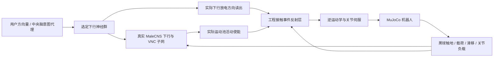

# VNC 接触闭环：移动意图、黑球反馈与等效肌群力

2026-10-22。用户 NBS V5 六足机器人，Windows Docker / MuJoCo，本机模拟，无实机连接。

## 这版方案的分工

方向量被视为中央脑产生的“移动想法”的代理，**没有模拟完整中央脑**。前后量与转向量范围均为 [-1,1]；先转换为选定 MaleCNS 下行神经群的输入率，经过真实下行/VNC 连接组传播，再读取运动神经元群活动。工程层负责把神经信号接到尺寸、质量和自由度与果蝇不同的机器人。



`backend/vnc.py` 不接收按钮命令或用户方向数组。它只接收实际神经活动解码值、物理感觉和停止保护。运动神经群平均活动必须超过阈值才使能，方向来自实际下行群放电差。为减少不同下行群的弱串扰，采用低通、15 Hz 活动底限和相对最大证据 55% 的选择规则。这些是工程读出假设，弱的混合意图可能被抑制，不能称为生理标定或线性方向映射。

## 黑球与地面反馈

只匹配指定足端球碰撞几何与 `ground` 的接触，不将其他身体碰撞误认为脚底反馈。读取 MuJoCo 的实际接触力：法向载荷 N、切向力 N；在实际接触点用雅可比与关节速度计算切向滑移 m/s，包含球体旋转效应。触地阈值采用滞回：超过 12 N 确认为触地，低于 5 N 才判定离地，减少数值抖动。

载荷按整机重量的六分之一归一化。触地、载荷、滑移和关节负载经有界频率编码送入现有 705 个感觉神经元中的相应工程通道；关节位置与速度编码保留。不是声称已经标定了各个果蝇感受器的真实调谐。脚部位置/运动信号参与 VNC 局部运动控制有实验与连接组依据，但本项目的具体编码仍是假设：[FeCO 感觉通路论文](https://www.nature.com/articles/s41467-025-59302-3)、[下行网络与群体运动控制](https://www.nature.com/articles/s41586-024-07523-9)。接触力与雅可比的实现按 [MuJoCo API](https://mujoco.readthedocs.io/en/stable/APIreference/APIfunctions.html#mj_contactForce)。

## 扭矩怎样换算等效肌群力

真实肌肉的关系是 `τ = R(q) F`；一个关节可有多条肌肉及共同收缩，仅凭净扭矩不能唯一反解所有肌肉力。本版采用机器人尺度上的单对抗肌群近似：

- 先将实际关节驱动力矩低通（80 ms）。
- 假设有效力臂：髋 35 mm、大腿 45 mm、小腿 35 mm，保存在 `backend/vnc.json`。
- `F正 = max(τ,0)/r`，`F负 = max(-τ,0)/r`；两者均非负，满足 `r × (F正-F负)=τ`。
- 界面显示单侧等效力大小，单位 N；不加入未知的共同收缩，不能理解为实测果蝇肌肉力或真实机器人肌肉张力。
- 相对驱动上限的负载程度进入感觉编码；高负载/滑移会压低运动速度。**估计力不直接作为另一份外力施加到身体**，避免与伺服力矩重复计算。

当前仍使用原来的关节位置伺服，而非新增 Hill 型肌肉或肌腱模型。工程反射给出关节参考，MuJoCo 求出实际力矩，力矩再换算等效力返回感觉通道。由于原模型约 107.63 kg，千牛量级等效力是机器人尺寸和假设力臂下的结果，不是果蝇力学尺度。

## 工程反射层怎样迈步

没有周期相位时钟，也不读取旧版 `cpg_targets()`。工程上指定交替的两组三足，限制摆足时另一组必须有实际地面支撑。支撑足相对机身后移到空间阈值后触发抬足；实际足端达到抬足高度后触发前摆，达到前方位置后下降；真实载荷确认三足触地后才切换下一组。

步距、抬足高度、三足分组、阈值、逆解及伺服都是**明确编写的工程运动接口**。这并不等于生物 VNC 自发产生节律。落足超过 2.5 s 未确认时锁定保持，需要复位。方向停止、超时、断线时回到静态参考，保留 250 mm 高度补偿。

## 验收结果及其限度

水平地面、六边形默认站姿、默认种子、先静站 10 s，再刺激。各模式没有修改原连接权重。

| 测试 | 时长 | 位移 / 转角 | 净空范围 | 最大力矩 | 警告 |
|---|---:|---:|---:|---:|---:|
| 前进意图 | 15 s 仿真 | +0.841 m，航向 +1.25° | 243.59–255.42 mm | 133.67 N·m | 0 |
| 后退意图 | 12 s 仿真 | -0.664 m，航向 +0.09° | 243.59–255.91 mm | 133.40 N·m | 0 |
| 左转意图 | 12 s 仿真 | +109.10° | 243.87–256.08 mm | 121.01 N·m | 0 |
| 右转意图 | 12 s 仿真 | -109.09° | 243.88–256.10 mm | 121.06 N·m | 0 |

每条腿完成至少 6 次确认落足。停止并收敛后，六球接地，净空约 250.045 mm。移动中净空随换足变化，不能保证恒为 250 mm。

消融对照均为 forward 6 s：

| 切断环节 | X 位移 | 落足循环 | 解释 |
|---|---:|---:|---|
| 全部突触传播 | 数值误差量级 | 0 | 下行神经元仍可被直接刺激，运动池不再使能 |
| 运动池读出 | 数值误差量级 | 0 | 神经脉冲仍继续，运动使能被关闭 |
| 工程接触解码入口 | 数值误差量级 | 0 | 工程反馈缺失联锁主动保持；这不是生物机制的证据 |
| 仅神经感觉输入 | +0.324 m | 每腿 3 次 | 工程反射仍能读取真实接触；说明目前步态协调主要在工程层，尚未证明神经感觉反馈是步行必需条件 |

提高关节负载与滑移、保持其他输入不变时，感觉 load 通道均值由 88.665 Hz 变为 173.665 Hz；证实这些量进入神经输入，但不能据此宣称其生理正确。力臂换算恒等式、地面承重平衡、混合意图输入、停止后收敛均通过。权重 SHA256 仍为 `2f547b0a84d24869e6a2a142a8437ffbb668cd47c1966595af3d72fefcbe61f2`。

在线 WebSocket 验收通过：前进/后退/左右意图、实际步数、神经时间推进、越界方向拒绝、独占控制、0.8 s 心跳停止、断线停止、跨来源请求拒绝。浏览器已验证键盘输入、50% 意图强度、松键停止及实时反馈表，无浏览器错误。

这些结果只支持**真实神经活动参与并使能的工程反射辅助运动**。未验证：完整中央脑、逐肌肉生物映射、原 VNC 自发步态、复杂地形、不同种子下的统计鲁棒性或实机。下一步应把工程层拆成可替换模块，逐项标定感觉调谐、肌群作用矩阵和真正 VNC 运动时序，而不是隐藏已有工程层。

## 操作与复测

打开本机 `http://127.0.0.1:8765/`，默认选择“VNC 接触闭环”。按住 W/A/S/D 或按钮输入想法，调节“意图强度”；松开停止。支持协议 `{"command":"move_intent","forward":0.6,"turn":0.25}`，心跳规则沿用原版，两个量可同时给出。旧版神经直接偏移和人工 CPG 均可显式选择作对照。

18 路实时扭矩与默认角度保存继续保留。恢复六边形、换模式或复位会复位神经状态和落足计数。原始 URDF、连接组、持久角度卷未改写。

```powershell
docker compose exec -T console python -m tests.vnc_verify
docker compose exec -T console python -m tests.vnc_live
docker compose exec -T console python -m tests.neural_verify
docker compose exec -T console python -m tests.controls_verify
docker compose exec -T console python -m tests.stance_verify
```

离线 VNC 验收会重新运行四方向；`--reuse-evidence` 仅适用于已有对应探针 JSON 的源码目录，不应把复用数据当作重新执行。在线测试会移动当前场景，请无人操控时运行。

数据位于 `evidence/vnc-acceptance.json`、`vnc-probe-*.json`、`vnc-live.json` 和回归 JSON。更新前源文件与镜像保留为 `backups/before-vnc-20261022/`、`hexapod-neuro:before-vnc-20261022`。
